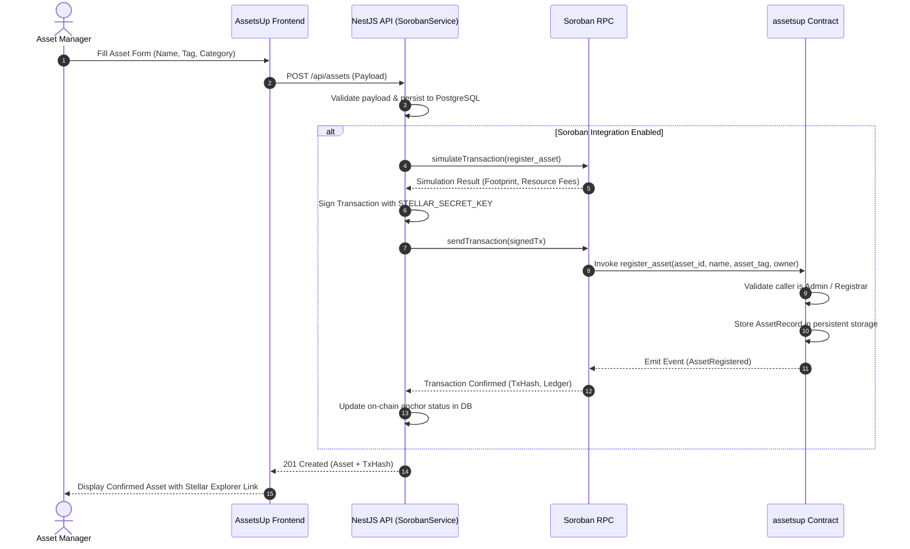
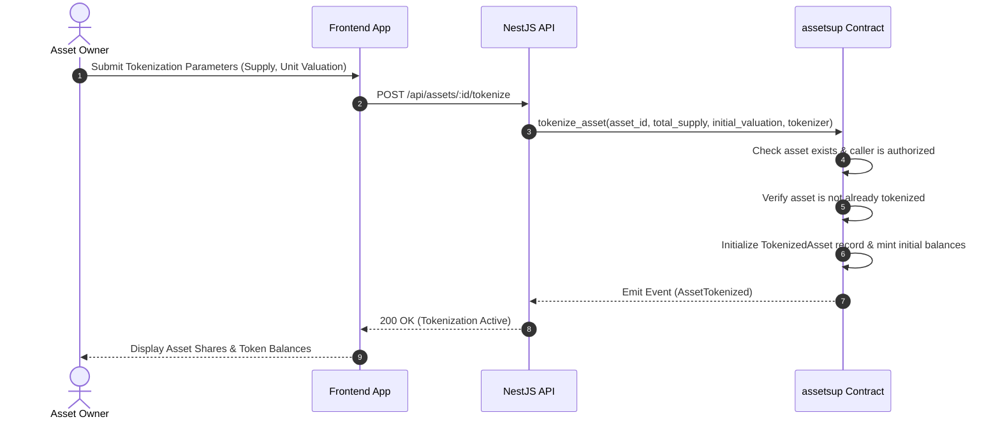

# AssetsUp On-Chain Contract Integration Guide

This guide details how the AssetsUp backend services and frontend interfaces integrate with the Soroban smart contracts on the Stellar network. It documents the asset lifecycle entrypoints, required environment configurations, deployment artifacts consumption, transaction error mapping to `contracts/ERRORS.md`, wallet signing architecture, and a step-by-step testnet walkthrough.

---

## 1. Architectural Overview & Responsibilities

AssetsUp relies on a modular set of five Soroban smart contracts deployed on the Stellar network:

```
┌────────────────────────────────────────────────────────────────────────┐
│                              Clients                                   │
│    ┌───────────────────────────┐      ┌───────────────────────────┐    │
│    │     Frontend App          │      │     Backend Service       │    │
│    │ (Next.js + Freighter Kit) │      │  (NestJS + SorobanService)│    │
│    └─────────────┬─────────────┘      └─────────────┬─────────────┘    │
└──────────────────┼──────────────────────────────────┼──────────────────┘
                   │ Client-Signed Invocations        │ Operator-Signed Invocations
                   ▼                                  ▼
┌────────────────────────────────────────────────────────────────────────┐
│                        Soroban RPC Provider                            │
│           (https://soroban-testnet.stellar.org or Standalone)          │
└──────────────────────────────────┬─────────────────────────────────────┘
                                   │
                                   ▼
┌────────────────────────────────────────────────────────────────────────┐
│                   AssetsUp Smart Contract Workspace                    │
│  ┌──────────────────────┐  ┌──────────────────────┐  ┌──────────────┐  │
│  │      assetsup        │  │  multisig-transfer   │  │asset-maint.  │  │
│  │ (Authoritative Asset │  │ (Approval Workflows  │  │ (Maintenance │  │
│  │  Registry & Tokens)  │  │  for Asset Moves)    │  │  & Warranty) │  │
│  └──────────────────────┘  └──────────────────────┘  └──────────────┘  │
│  ┌──────────────────────┐  ┌──────────────────────┐                    │
│  │       contrib        │  │   multisig-wallet    │                    │
│  │ (Auxiliary Registry, │  │ (General Governance  │                    │
│  │  KYC, Staking/Escrow)│  │  & Threshold Signing)│                    │
│  └──────────────────────┘  └──────────────────────┘                    │
└────────────────────────────────────────────────────────────────────────┘
```

### Contract Responsibilities

| Contract | Role in AssetsUp Architecture |
|---|---|
| **`assetsup`** | **Primary authoritative registry.** Holds asset metadata, physical tags, ownership state, tokenization, dividend distributions, governance voting, detokenization, and leasing. |
| **`contrib`** | **Auxiliary operations.** Provides KYC records, audit trails, staking deposits, and escrow rails. |
| **`multisig-transfer`** | **Governed transfers.** Enforces approval rules, threshold requirements, and multi-party signoffs for high-value asset reassignments before calling `assetsup::transfer_ownership`. |
| **`multisig-wallet`** | **Governance treasury.** General-purpose $m$-of-$n$ wallet managing threshold transactions and administrative rotations. |
| **`asset-maintenance`** | **Operational lifecycle.** Tracks maintenance intervals, service logs, alerts, warranty validity, and approved service providers. |

---

## 2. Signing Architecture: Frontend Wallet vs Backend Signer

AssetsUp uses a dual-signer model to separate server-orchestrated administrative tasks from user-authenticated ownership actions:

| Dimension | Backend Signer (`SorobanService`) | Frontend Wallet (`Freighter` / Stellar Wallets Kit) |
|---|---|---|
| **Key Custody** | Server-side environment variable (`STELLAR_SECRET_KEY`) | Client-side extension (user private key never leaves the wallet) |
| **Primary Scope** | Asset ingestion, automated status synchronization, system-level registry initialization, scheduled reconciliations | User-initiated asset ownership transfers, multisig transfer approvals, voting on asset proposals, token claims |
| **Authorization Type** | System Operator / Contract Administrator identity | Individual asset owner, department delegate, or designated multisig approver |
| **Transaction Flow** | Backend builds, simulates, signs, and submits directly to Soroban RPC | Frontend builds XDR, requests wallet signature via popup, and submits or passes signed XDR to backend |

---

## 3. Sequence Diagrams

### A. Asset Registration Lifecycle

When an asset is registered through the AssetsUp system, the backend records the asset in the operational database and anchors its identity and initial ownership on-chain.



---

### B. Governed Ownership Transfer via `multisig-transfer`

For high-value assets requiring multi-party authorization, ownership reassignments follow a governed workflow before state is committed in `assetsup`.

```mermaid
sequenceDiagram
    autonumber
    actor Originator as Department Lead
    actor Approver as Finance Director
    participant UI as Frontend App
    participant Wallet as Freighter Wallet
    participant MSContract as multisig-transfer Contract
    participant RegContract as assetsup Contract

    Originator->>UI: Request Asset Transfer to New Department
    UI->>Wallet: Request Signature (create_transfer_request)
    Wallet-->>UI: Signed Transaction
    UI->>MSContract: create_transfer_request(asset_id, new_owner, rule_id)
    MSContract->>MSContract: Check asset status & register pending request
    MSContract-->>UI: Request ID Created

    Approver->>UI: Review Pending Transfer Request
    UI->>Wallet: Sign Approval (approve_transfer)
    Wallet-->>UI: Signed Transaction
    UI->>MSContract: approve_transfer(request_id)
    MSContract->>MSContract: Increment approvals; check threshold rule
    alt Threshold Satisfied
        MSContract->>RegContract: transfer_ownership(asset_id, new_owner)
        RegContract->>RegContract: Verify caller is multisig-transfer contract
        RegContract->>RegContract: Update Owner to new_owner
        RegContract-->>MSContract: Ok
        MSContract-->>UI: Transfer Executed
    else Threshold Pending
        MSContract-->>UI: Approval Recorded (Pending additional signatures)
    end
```

---

### C. Asset Tokenization Lifecycle



---

## 4. Environment Variables Reference

### Backend (`backend/.env`)

These variables govern `SorobanService` ([`backend/src/stellar/soroban.service.ts`](../backend/src/stellar/soroban.service.ts)):

| Variable | Required | Type | Description | Default / Example |
|---|---|---|---|---|
| `STELLAR_NETWORK` | **Yes** | String | Target network tier (`testnet`, `futurenet`, or `mainnet`) | `testnet` |
| `SOROBAN_RPC_URL` | Optional | URL | Soroban RPC endpoint | `https://soroban-testnet.stellar.org` |
| `ASSETSUP_CONTRACT_ID` | **Yes** | StrKey Address | StrKey-encoded address of the primary `assetsup` contract | `CAAAAAAAAAAAAAAAAAAAAAAAAAAAAAAAAAAAAAAAAAAAAAAAAAAAAAAA` |
| `STELLAR_SECRET_KEY` | **Yes** | Stellar Secret | S-encoded secret key used by backend to sign operator transactions | `SDUMMY...` |
| `SOROBAN_POLL_INTERVAL_MS`| Optional | Integer | Milliseconds between transaction finality polling attempts | `2000` |
| `SOROBAN_TIMEOUT_MS` | Optional | Integer | Maximum milliseconds to wait for transaction confirmation | `30000` |

### Frontend (`frontend/.env.local`)

These variables configure client-side wallet connections and contract addresses:

| Variable | Required | Description | Example |
|---|---|---|---|
| `NEXT_PUBLIC_STELLAR_NETWORK` | **Yes** | Stellar network identifier consumed by wallet adapters (`testnet` or `mainnet`) | `testnet` |
| `NEXT_PUBLIC_SOROBAN_RPC_URL` | Optional | Public Soroban RPC endpoint used by client simulation helpers | `https://soroban-testnet.stellar.org` |
| `NEXT_PUBLIC_ASSETSUP_CONTRACT_ID` | **Yes** | Primary `assetsup` contract address | `CAAA...` |
| `NEXT_PUBLIC_MULTISIG_TRANSFER_CONTRACT_ID` | Optional | `multisig-transfer` contract address for governed workflows | `CEEE...` |

---

## 5. Deployment Artifacts Consumption (`deployments/<network>.json`)

The smart contract workspace outputs deployment manifests under `contracts/deployments/`:

```json
{
  "network": "testnet",
  "admin": "GBRPYHIL2CI3FNQ4BXLFMNDLFJUNPU2HY3ZMFTG坡6...",
  "deployedAt": "2026-10-26T12:00:00Z",
  "contracts": {
    "assetsup": "CAAAAAAAAAAAAAAAAAAAAAAAAAAAAAAAAAAAAAAAAAAAAAAAAAAAAAAA",
    "contrib": "CBBBBBBBBBBBBBBBBBBBBBBBBBBBBBBBBBBBBBBBBBBBBBBBBBBBBBBB",
    "multisig-wallet": "CCCCCCCCCCCCCCCCCCCCCCCCCCCCCCCCCCCCCCCCCCCCCCCCCCCCCCCC",
    "asset-maintenance": "CDDDDDDDDDDDDDDDDDDDDDDDDDDDDDDDDDDDDDDDDDDDDDDDDDDDDDDD",
    "multisig-transfer": "CEEEEEEEEEEEEEEEEEEEEEEEEEEEEEEEEEEEEEEEEEEEEEEEEEEEEEEE"
  }
}
```

### Ingestion Flow:
1. **Deployment Phase:** Running deployment scripts (`contracts/scripts/deploy.sh`) compiles optimized WASM targets, deploys contracts via `stellar contract deploy`, initializes admin keys, and updates `contracts/deployments/<network>.json`.
2. **Backend Configuration:** In production or staging, `ASSETSUP_CONTRACT_ID` is set directly from the `contracts.assetsup` value in the manifest.
3. **Frontend Sync:** The frontend reads `contracts.assetsup` and `contracts.multisig-transfer` to route interactive transactions to the active contract addresses.

---

## 6. Error Handling & Taxonomy Mapping

When invoking contracts through the Stellar RPC, errors return as raw `u32` status codes embedded in `Error(Contract, #XYZ)`. AssetsUp uses non-overlapping numeric allocations documented in [`contracts/ERRORS.md`](../contracts/ERRORS.md):

```
Code Range:
  1 –  99   ──► Shared Cross-Cutting Errors
100 – 199   ──► assetsup Primary Registry Errors
200 – 299   ──► contrib Secondary Registry Errors
300 – 399   ──► multisig-wallet Governance Errors
400 – 499   ──► multisig-transfer Workflow Errors
500 – 599   ──► asset-maintenance Errors
```

### High-Frequency Errors and Client Remediation

| Code | Contract | Variant | Meaning | Remediation |
|---:|---|---|---|---|
| `1` | Shared | `AlreadyInitialized` | Initialization entrypoint invoked on already active contract. | Do not re-initialize; inspect existing state. |
| `2` | Shared | `NotInitialized` | Entrypoint called before contract admin was set. | Invoke `initialize` with the operator account. |
| `3` | Shared | `Unauthorized` | Caller identity lacks required role or signature auth. | Verify signing key matches asset owner or admin. |
| `6` | Shared | `ContractPaused` | Mutating entrypoint blocked by emergency pause. | Wait for administrator `unpause` invocation. |
| `100` | `assetsup` | `AssetAlreadyExists` | Asset with this `asset_id` is already registered. | Use a unique numeric asset ID. |
| `101` | `assetsup` | `AssetNotFound` | Referenced asset does not exist in registry. | Verify asset ID before submitting update/transfer. |
| `120` | `assetsup` | `InvalidTokenSupply` | Tokenization supply must be greater than zero. | Specify positive integer share supply. |
| `121` | `assetsup` | `AssetAlreadyTokenized`| Asset has already been split into fractional shares. | Re-tokenization is prohibited; manage existing shares. |
| `400` | `multisig-transfer`| `RequestNotFound` | Transfer request ID not found or already settled. | Query active pending transfer requests. |
| `401` | `multisig-transfer`| `AlreadyApproved` | Approver has already signed this request. | Await remaining required approvers. |

---

## 7. Step-by-Step Walkthrough: Registering an Asset on Testnet

This section provides a standalone walkthrough for a new contributor to fund an identity, configure environment variables, deploy the contract, and execute an asset registration on the public Stellar testnet.

### Step 1: Install Prerequisites

Ensure you have the Stellar CLI installed:
```bash
cargo install --locked stellar-cli
```

### Step 2: Generate and Fund a Testnet Keypair

```bash
# Generate operator identity
stellar keys generate --global assetsup-operator --network testnet

# Fund with testnet lumens via Friendbot
stellar keys fund assetsup-operator --network testnet

# Export public address and secret key
export OPERATOR_ADDRESS="$(stellar keys address assetsup-operator)"
export OPERATOR_SECRET="$(stellar keys secret assetsup-operator)"
echo "Operator Address: $OPERATOR_ADDRESS"
```

### Step 3: Build and Deploy the `assetsup` Contract

```bash
cd contracts

# Build optimized WASM
cargo build --release --target wasm32-unknown-unknown

# Deploy contract to testnet
export ASSETSUP_CONTRACT_ID="$(stellar contract deploy \
  --wasm target/wasm32-unknown-unknown/release/assetsup.wasm \
  --source assetsup-operator \
  --network testnet)"

echo "Deployed Contract ID: $ASSETSUP_CONTRACT_ID"

# Initialize contract admin
stellar contract invoke \
  --id "$ASSETSUP_CONTRACT_ID" \
  --source assetsup-operator \
  --network testnet \
  -- initialize --admin "$OPERATOR_ADDRESS"

cd ..
```

### Step 4: Configure the Backend Environment

In `backend/.env`:
```env
STELLAR_NETWORK=testnet
SOROBAN_RPC_URL=https://soroban-testnet.stellar.org
ASSETSUP_CONTRACT_ID=<PASTE_ASSETSUP_CONTRACT_ID_HERE>
STELLAR_SECRET_KEY=<PASTE_OPERATOR_SECRET_HERE>
```

### Step 5: Execute On-Chain Asset Registration

Invoke `register_asset` directly using the CLI:

```bash
stellar contract invoke \
  --id "$ASSETSUP_CONTRACT_ID" \
  --source assetsup-operator \
  --network testnet \
  -- register_asset \
  --asset_id 101 \
  --name "Server Rack Alpha-1" \
  --asset_tag "SRV-2026-001" \
  --owner "$OPERATOR_ADDRESS"
```

### Step 6: Verify Registered Asset On-Chain

Read back the registered asset record:

```bash
stellar contract invoke \
  --id "$ASSETSUP_CONTRACT_ID" \
  --source assetsup-operator \
  --network testnet \
  -- get_asset \
  --asset_id 101
```

Expected output:
```json
{
  "asset_id": 101,
  "asset_tag": "SRV-2026-001",
  "created_at": 1729987200,
  "name": "Server Rack Alpha-1",
  "owner": "GBRPYHIL2CI3FNQ4BXLFMNDLFJUNPU2HY3ZMFTG...",
  "status": 0
}
```

The asset is now permanently recorded and verified on the Stellar testnet.
